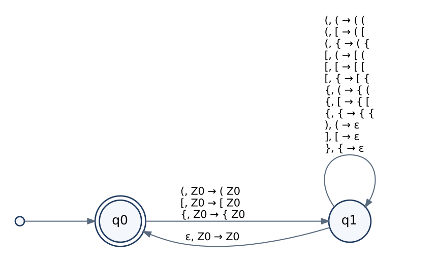
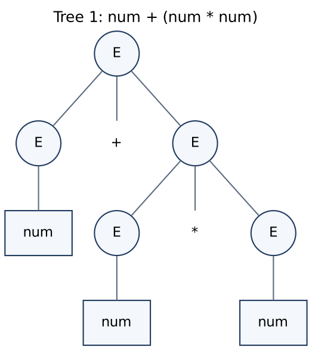
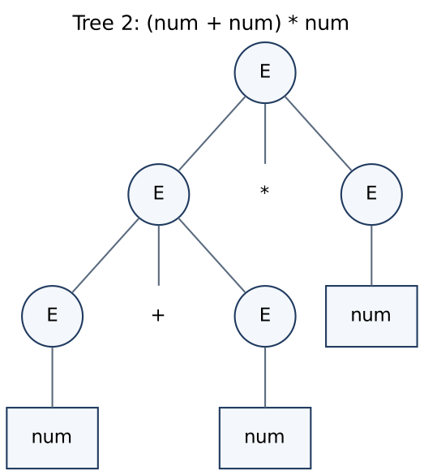
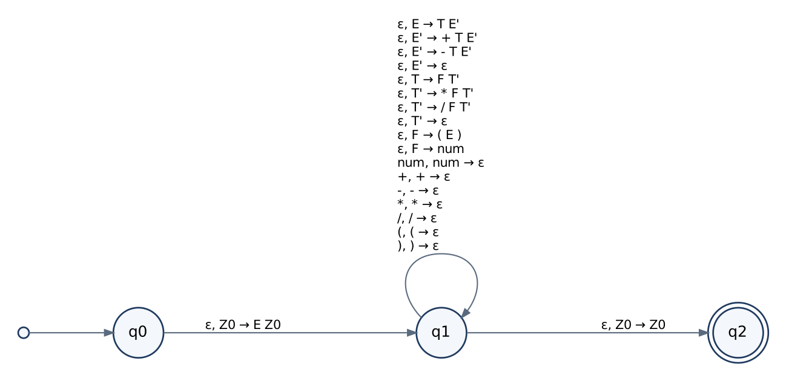
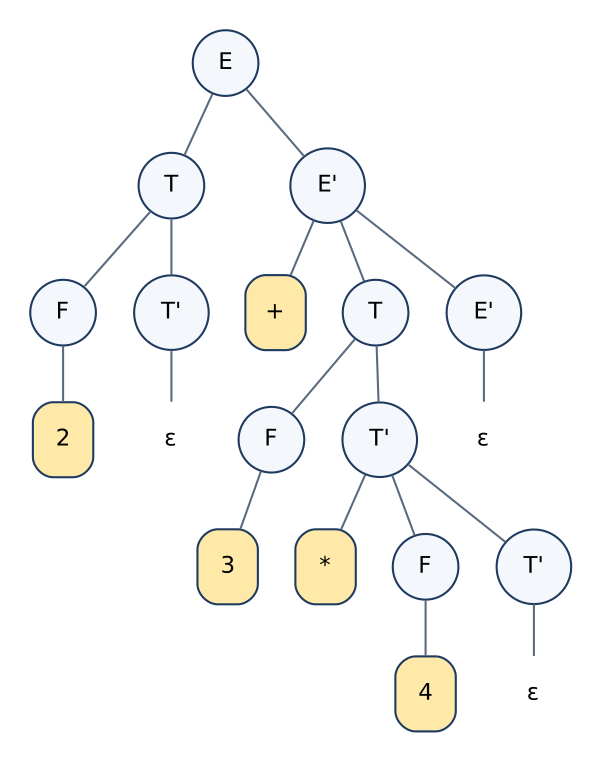
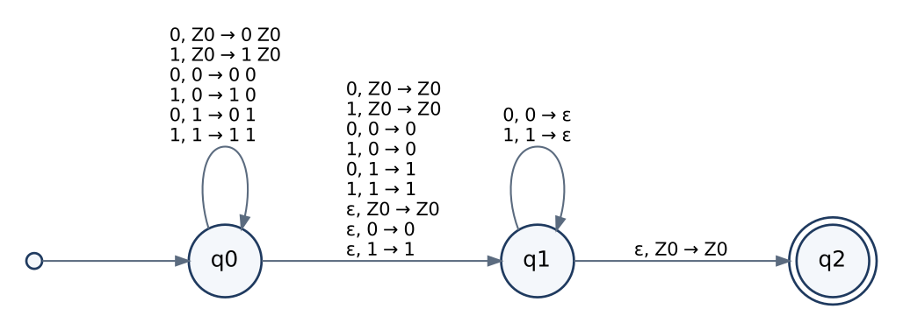

# Case Study Report – Analysis and Design using Pushdown Automata and Context-Free Grammars

**Course:** 21CSC301T – Formal Language and Automata · **Assignment 3** · AY 2026–2027, Semester V
**Student:** `<Name>` · **Register No.:** `<Register Number>` · **Faculty:** Dr. C. Gunasundari

---

## 1. Objective and Models

Three languages that no finite automaton can recognise are modelled with a
context-free grammar (CFG) and a pushdown automaton (PDA), and validated with
accepted and rejected strings.

**CFG.** G = (V, T, P, S): variables, terminals, productions A → α with A ∈ V and
α ∈ (V ∪ T)\*, start variable S. L(G) = { w ∈ T\* : S ⇒\* w } [1, §5.1].

**PDA.** P = (Q, Σ, Γ, δ, q₀, Z₀, F) with δ : Q × (Σ ∪ {ε}) × Γ → finite subsets of
Q × Γ\* [1, §6.1]. A move δ(q, a, X) ∋ (p, γ) reads a (or nothing when a = ε), pops X
and pushes γ with its leftmost symbol on top. A configuration is (q, w, α): state,
remaining input, stack (top first). All PDAs here accept by **final state**.

**Determinism.** A PDA is deterministic when (i) |δ(q, a, X)| ≤ 1 for all q, a, X and
(ii) if δ(q, ε, X) ≠ ∅ then δ(q, a, X) = ∅ for every a ∈ Σ [1, §6.4]. The program
checks these two conditions for each PDA (`PDA.is_deterministic`).

**How the application works.** `pda/pda.py` stores δ as a list of rules and explores
every computation by breadth-first search over configurations. Acceptance is decided
only by δ; no direct string test is used. `pda/cfg.py` converts a grammar into its
top-down PDA and reads the leftmost derivation off the accepting computation.

Generated material: [`transition_tables.md`](transition_tables.md) (complete δ for the
three PDAs) and [`worked_examples.md`](worked_examples.md) (stack traces and
derivations produced by the simulator).

---

## 2. Case Study 1 – Balanced Parentheses

### 2.1 Language and alphabet
Σ = { ( , ) , [ , ] , { , } }.
L_bal is the smallest set such that ε ∈ L_bal and, if x, y ∈ L_bal, then
(x)y, [x]y, {x}y ∈ L_bal.

### 2.2 Why a finite automaton is insufficient
Assume L_bal is regular with pumping length p. Take w = (ᵖ)ᵖ ∈ L_bal. For any split
w = xyz with |xy| ≤ p, |y| ≥ 1, the part y contains only `(`. Then xy²z has more `(`
than `)` and is not in L_bal, contradicting the pumping lemma [1, §4.1]. A DFA with k
states can distinguish at most k nesting depths; the depth here is unbounded.

### 2.3 Context-free grammar
G_bal = ({S}, Σ, P, S)

```
S → ( S ) S | [ S ] S | { S } S | ε
```

| Production | Meaning |
|---|---|
| S → ( S ) S | A balanced string may start with a `( … )` pair around a balanced string, followed by a balanced string |
| S → [ S ] S | Same for square brackets |
| S → { S } S | Same for braces |
| S → ε | The empty string is balanced; ends the recursion |

### 2.4 Pushdown automaton
P_bal = ({q0, q1}, Σ, {Z0, (, [, {}, δ, q0, Z0, {q0})



| Transition (o, x ∈ {(, [, {}; c = partner of o) | Operation | Purpose |
|---|---|---|
| δ(q0, o, Z0) = (q1, o Z0) | push o | first open bracket |
| δ(q1, o, x) = (q1, o x) | push o | further open bracket |
| δ(q1, c, o) = (q1, ε) | pop o | closing bracket matches the top |
| δ(q1, ε, Z0) = (q0, Z0) | none | stack back to Z0: everything is closed |

- **q0** (start, final): the stack holds only Z0, so nothing is waiting to be closed.
- **q1**: at least one open bracket is on the stack.
- **Stack symbols:** Z0 (bottom marker) and the three open brackets.

### 2.5 Successful processing – `([]{})`

| Step | State | Remaining input | Stack | Operation |
|---|---|---|---|---|
| 0 | q0 | ([]{}) | Z0 | – |
| 1 | q1 | []{}) | ( Z0 | push ( |
| 2 | q1 | ]{}) | [ ( Z0 | push [ |
| 3 | q1 | {}) | ( Z0 | pop [ |
| 4 | q1 | }) | { ( Z0 | push { |
| 5 | q1 | ) | ( Z0 | pop { |
| 6 | q1 | ε | Z0 | pop ( |
| 7 | q0 | ε | Z0 | ε-move, **accept** |

Leftmost derivation:
S ⇒ (S)S ⇒ ([S]S)S ⇒ ([]S)S ⇒ ([]{S}S)S ⇒ ([]{}S)S ⇒ ([]{})S ⇒ ([]{})

### 2.6 Unsuccessful processing
- `([)]`: after `([` the stack is `[ ( Z0`. The next symbol is `)` but δ(q1, ), [) is
  undefined – **rejected** (brackets cross). In the grammar, the derivation reaches
  ( [ S ] S ) S and no production of S can produce `)` at that position.
- `(()`: input ends in q1 with stack `( Z0`; q1 is not final – **rejected**.
- `)`: δ(q0, ), Z0) is undefined – **rejected**.

### 2.7 Ambiguity and determinism
- **Determinism:** P_bal satisfies both DPDA conditions (the only ε-move is on
  (q1, Z0), where no input move exists). L_bal is a deterministic CFL.
- **Ambiguity:** the natural grammar `S → SS | (S) | [S] | {S} | ε` is ambiguous;
  `()()()` can be derived as (S S) S or S (S S), giving two parse trees.
- **Revised grammar:** G_bal above. The next input symbol selects exactly one
  production (an open bracket selects its own rule; anything else selects ε), so each
  string has one leftmost derivation. G_bal is LL(1).

---

## 3. Case Study 2 – Arithmetic Expressions

### 3.1 Language and alphabet
Characters: digits, `.`, `+ - * /`, `( )`, spaces. A finite-state **lexer** converts
characters into tokens; every number `digit⁺(.digit⁺)?` becomes the terminal **num**.
Token alphabet: Σ = { num, +, −, \*, /, (, ) }.
L_exp = L(G2) = well-formed infix expressions with binary operators and parentheses.

Assumptions: numbers are unsigned; unary minus is not in the language; division by
zero is a semantic error (4/0 is syntactically valid).

### 3.2 Why a finite automaton is insufficient
(ⁿ num )ⁿ ∈ L_exp for every n. Pumping inside the block of `(` gives a string with
unmatched parentheses, so L_exp is not regular. (Without parentheses the language
num (op num)\* would be regular – nesting is what requires the stack.)

### 3.3 Grammars

**G1 – ambiguous**
```
E → E + E | E - E | E * E | E / E | ( E ) | num
```
num + num \* num has two leftmost derivations:

1. E ⇒ E + E ⇒ num + E ⇒ num + E \* E ⇒ num + num \* E ⇒ num + num \* num
2. E ⇒ E \* E ⇒ E + E \* E ⇒ num + E \* E ⇒ num + num \* E ⇒ num + num \* num

| Tree 1: num + (num \* num) | Tree 2: (num + num) \* num |
|---|---|
|  |  |

For 2 + 3 \* 4 the trees mean 14 and 20, so G1 does not define precedence.

**G2 – revised, unambiguous**
```
E → E + T | E - T | T          (lowest precedence, left-associative)
T → T * F | T / F | F          (higher precedence, left-associative)
F → ( E ) | num                (highest: atoms and parentheses)
```
`*` and `/` can only be generated inside a T, so they bind tighter than `+` and `−`;
left recursion gives left associativity (8 − 3 − 2 = (8 − 3) − 2).
Derivation of num + num \* num in G2:
E ⇒ E + T ⇒ T + T ⇒ F + T ⇒ num + T ⇒ num + T \* F ⇒ num + F \* F ⇒ num + num \* F ⇒ num + num \* num

**G3 – G2 with left recursion removed (used for the PDA)**
Using A → Aα | β ⟹ A → βA′, A′ → αA′ | ε [5, §4.3]:
```
E  → T E'
E' → + T E' | - T E' | ε
T  → F T'
T' → * F T' | / F T' | ε
F  → ( E ) | num
```

| Production | Meaning |
|---|---|
| E → T E' | expression = term followed by an optional tail |
| E' → + T E' / − T E' | tail adds or subtracts another term |
| E' → ε | tail ends |
| T → F T' | term = factor followed by an optional tail |
| T' → \* F T' / / F T' | tail multiplies or divides by another factor |
| T' → ε | tail ends |
| F → ( E ) | parenthesised expression (nesting) |
| F → num | a number |

### 3.4 Pushdown automaton
Built from G3 by the standard CFG → PDA construction [1, §6.3]:
P_exp = ({q0, q1, q2}, Σ, {Z0} ∪ V ∪ Σ, δ, q0, Z0, {q2})



| Transition | Purpose |
|---|---|
| δ(q0, ε, Z0) = {(q1, E Z0)} | put the start variable on the stack |
| δ(q1, ε, A) ∋ (q1, α) for every A → α in G3 | **expand** a variable (one derivation step) |
| δ(q1, a, a) = {(q1, ε)} for every a ∈ Σ | **match** a terminal with the input |
| δ(q1, ε, Z0) = {(q2, Z0)} | derivation complete: accept |

The full list (19 transitions) is in `transition_tables.md`.

### 3.5 Successful and unsuccessful processing
- `2+3*4` – accepted. Stack trace (18 moves) in `worked_examples.md`. Parse tree:

  

  The `*` sits lower in the tree than `+`, so it is applied first: value 14.
- `(2+3)*4` – accepted; value 20 (parentheses override precedence).
- `2+*3` – rejected at token 3: after `num +` the stack top is T, and every expansion
  of T begins with `num` or `(`, never `*`.
- `(2+3` – rejected: input ends while `)` is still on the stack.
- `2 3`, `()`, `2+`, `*3` – rejected (see test table).

### 3.6 Ambiguity and determinism
G1 is ambiguous; G2 and G3 are unambiguous. P_exp is nondeterministic as a PDA
(several ε-expansions for E′, T′, F), but G3 is LL(1): the next token always
identifies the only expansion that can succeed, so L_exp is a deterministic CFL and
practical parsers do not backtrack. The simulator explores all branches; wrong ones
die after one move.

---

## 4. Case Study 3 – Palindromes

### 4.1 Language and alphabet
Σ = {0, 1}; L_pal = { w ∈ Σ\* : w = wᴿ } (even and odd length, including ε).

### 4.2 Why a finite automaton is insufficient
Take w = 0ᵖ10ᵖ ∈ L_pal. With |xy| ≤ p, y lies in the first block of 0s; xy²z =
0ᵖ⁺ᵏ10ᵖ is not a palindrome. Hence L_pal is not regular.

### 4.3 Context-free grammar
G_pal = ({S}, {0, 1}, P, S)
```
S → 0 S 0 | 1 S 1 | 0 | 1 | ε
```
| Production | Meaning |
|---|---|
| S → 0 S 0, S → 1 S 1 | equal first and last symbols around a smaller palindrome |
| S → 0, S → 1 | middle symbol of an odd-length palindrome |
| S → ε | centre of an even-length palindrome |

### 4.4 Pushdown automaton
P_pal = ({q0, q1, q2}, {0, 1}, {Z0, 0, 1}, δ, q0, Z0, {q2}); a ∈ {0,1}, X ∈ {Z0, 0, 1}



| Transition | Purpose |
|---|---|
| δ(q0, a, X) ∋ (q0, aX) | push phase: copy the first half onto the stack |
| δ(q0, a, X) ∋ (q1, X) | guess: a is the middle symbol (odd length); do not push |
| δ(q0, ε, X) ∋ (q1, X) | guess: the middle is here (even length) |
| δ(q1, a, a) = {(q1, ε)} | pop phase: input symbol equals stack top |
| δ(q1, ε, Z0) = {(q2, Z0)} | second half matched the reversed first half: accept |

### 4.5 Nondeterministic midpoint guessing
In q0 the same (input, top) pair allows three different moves, so the PDA is
nondeterministic. For an input of length n the simulator follows 2n + 1 branches (one
per possible midpoint); the input is accepted iff at least one branch reaches q2.

Branches for `0110` (accepted):

| Midpoint guess | Outcome |
|---|---|
| even: middle after 2 symbols | **ACCEPT** |
| even: middle after 0 symbols | dies: stack emptied with 4 symbols left |
| even: middle after 1 symbol | dies at symbol 2: input 1 ≠ top 0 |
| even: middle after 3 symbols | dies: input 0 ≠ top 1 |
| even: middle after 4 symbols | dies: input ended with 4 symbols on the stack |
| odd guesses (4 branches) | all die |

Accepting computation:
(q0, 0110, Z0) ⊢ (q0, 110, 0Z0) ⊢ (q0, 10, 10Z0) ⊢ (q1, 10, 10Z0) ⊢ (q1, 0, 0Z0) ⊢ (q1, ε, Z0) ⊢ (q2, ε, Z0)

Derivation: S ⇒ 0S0 ⇒ 01S10 ⇒ 0110

Unsuccessful example `0111`: all 9 branches die (table in `worked_examples.md`), and
no derivation exists.

### 4.6 Ambiguity and determinism
- **Why nondeterminism is unavoidable:** L_pal is a CFL but not a deterministic CFL.
  Reading left to right, nothing marks the middle, and a deterministic machine would
  have to decide when to stop pushing without knowing the remaining length. (The
  marked language { w c wᴿ } does have a DPDA [1, §6.4].)
- **Ambiguity:** G_pal is unambiguous – the outer symbols fix the production and the
  inside is again a palindrome. This case shows that a language can need a
  nondeterministic machine and still have an unambiguous grammar.
- **Revised grammar:** not required.

---

## 5. Test Strings (all executed by `pytest`; 60 tests passed – see `test_results.txt`)

| Case | Accepted | Rejected |
|---|---|---|
| Balanced | ε, `()`, `([]{})`, `{[()()]}`, `()[]{}`, `((((()))))`, `{[]}([])` | `(`, `)`, `(]`, `([)]`, `(()`, `())`, `{[}]` |
| Arithmetic | `7`, `2+3*4`, `(2+3)*4`, `10/2-3`, `8-3-2`, `((1+2)*(3-4))/5`, `3.5 * (2 + 0.25)` | `2+`, `*3`, `2++3`, `(2+3`, `2+3)`, `()`, `2 3`, `2+a`, ε |
| Palindrome | ε, `0`, `11`, `010`, `0110`, `10101`, `1001001` | `01`, `001`, `0111`, `10100`, `110100`, `012` |

**Additional validation.** The tests also compare (a) the bracket PDA with an
independent reduction procedure on all 55,987 strings of length ≤ 6, (b) the palindrome
PDA with the definition w = wᴿ on all 4,095 binary strings of length ≤ 11, (c) each
grammar with its hand-built PDA on the same sets, and (d) the expression PDA with an
independent recursive-descent recogniser on 4,000 random token sequences. All agree.

## 6. Summary

| Case | Regular? | Class | PDA | Natural grammar ambiguous? | Revision |
|---|---|---|---|---|---|
| Balanced brackets | No | DCFL | DPDA, 2 states | Yes | S → (S)S \| [S]S \| {S}S \| ε |
| Arithmetic expressions | No | DCFL | 3 states, from grammar | Yes | E/T/F precedence grammar |
| Binary palindromes | No | CFL, not DCFL | NPDA, 3 states | No | – |

## 7. Limitations

1. A PDA has one stack: { aⁿbⁿcⁿ } and { ww } are not context-free.
2. Only syntax is checked: `4/0` is accepted; meaning is checked after parsing.
3. Simulating nondeterminism costs time (2n + 1 branches for palindromes); real parsers
   use deterministic LL/LR grammars.
4. Ambiguity of an arbitrary CFG is undecidable [1, §9.5]; the revisions here were
   designed and argued by hand.
5. The expression language omits unary minus, identifiers and exponentiation.

## 8. Relevance to SDG 9
Parsers built on CFG/PDA theory are core infrastructure of compilers, interpreters and
data-format validators; formal, testable syntax checking supports reliable software
infrastructure (SDG 9).

## 9. References

1. J. E. Hopcroft, R. Motwani and J. D. Ullman, *Introduction to Automata Theory, Languages, and Computation*, 3rd ed., Pearson, 2007.
2. M. Sipser, *Introduction to the Theory of Computation*, 3rd ed., Cengage Learning, 2013.
3. P. Linz, *An Introduction to Formal Languages and Automata*, 6th ed., Jones & Bartlett, 2017.
4. D. C. Kozen, *Automata and Computability*, Springer, 1997.
5. A. V. Aho, M. S. Lam, R. Sethi and J. D. Ullman, *Compilers: Principles, Techniques, and Tools*, 2nd ed., Pearson, 2007.
6. Streamlit documentation, https://docs.streamlit.io · Graphviz documentation, https://graphviz.org/documentation/
